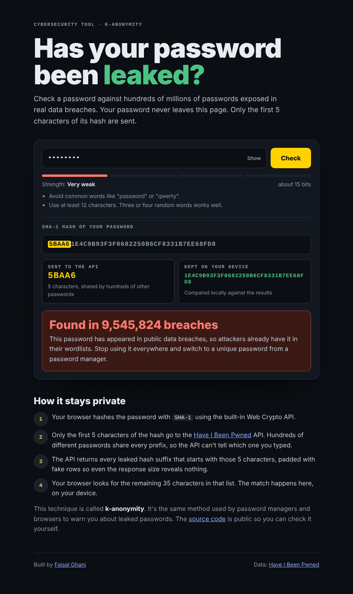
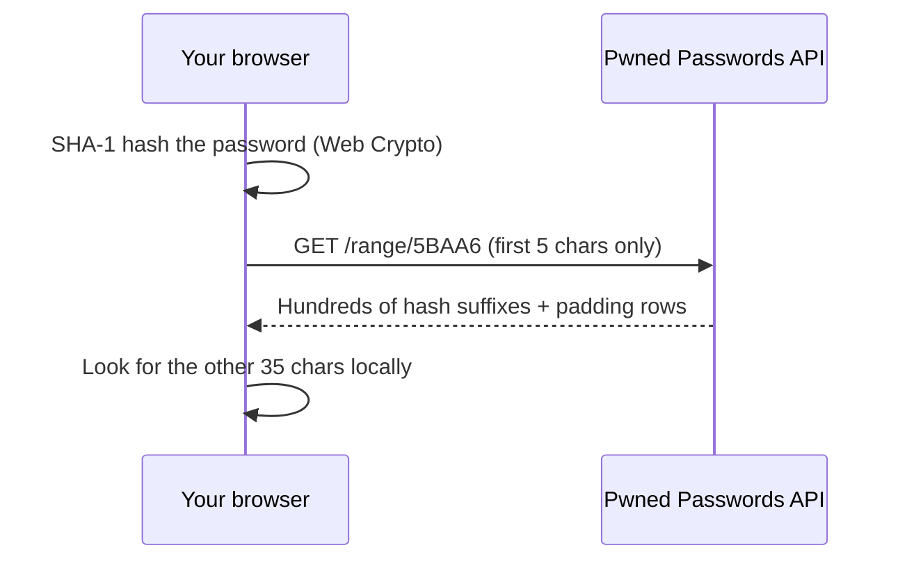

# Pwned Check

[](https://github.com/FaisalGhani786/pwned-check/actions/workflows/test.yml)

**Check if a password has appeared in a data breach, without the password ever leaving your device.**

**Live demo:** https://faisalghani786.github.io/pwned-check/



## How it works

The tool uses **k-anonymity** with the [Have I Been Pwned](https://haveibeenpwned.com/Passwords) Pwned Passwords API:



1. The browser hashes the password with SHA-1 using the built-in Web Crypto API.
2. Only the first 5 characters of the hash are sent. Hundreds of passwords share each prefix, so the API can't tell which one you typed.
3. The API returns every leaked suffix for that prefix. The `Add-Padding` header adds fake rows so the response size doesn't leak anything either.
4. The browser checks for the remaining 35 characters locally.

The password and full hash never leave the page. The test suite checks this.

## Features

- Breach check against hundreds of millions of leaked passwords
- Live strength meter that explains *why* a password is weak (common words, sequences, short length)
- A visual breakdown of exactly what is sent and what stays on your device
- No dependencies, no build step, no tracking

## Project structure

```
src/pwned.js      Hashing, k-anonymity split, API call, response parsing
src/strength.js   Explainable strength estimate
app.js            UI wiring
test/             Unit tests (Node's built-in test runner)
```

`checkPassword()` takes an injectable `fetch`, so the logic is tested without the network.

## Run it locally

```bash
git clone https://github.com/FaisalGhani786/pwned-check.git
cd pwned-check
python3 -m http.server 8000   # then open http://localhost:8000
npm test                      # runs the unit tests (Node 18+)
```

## Built with

HTML, CSS, JavaScript (ES modules), Web Crypto API, Node test runner, GitHub Actions, GitHub Pages.

## Credits

Breach data from [Have I Been Pwned](https://haveibeenpwned.com/) by Troy Hunt (Pwned Passwords is free to use, no API key needed).

---

Built by [Faisal Ghani](https://faisalghani786.github.io) · [LinkedIn](https://www.linkedin.com/in/fa1salg/)
